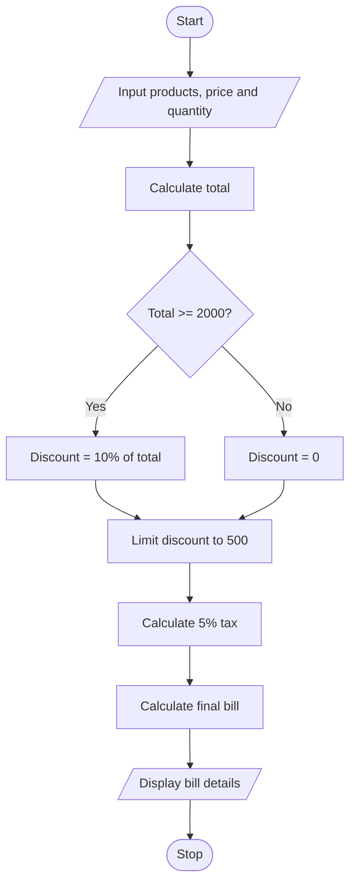

# Retail Billing Program

## 1. Problem Statement

Write a Python program to calculate the total bill for multiple products. The program should accept the price and quantity of each product, apply a 10% discount if the total is ₹2000 or more (with a maximum discount of ₹500), calculate 5% tax, and display the final bill.

## 2. Algorithm

1. Start.
2. Read the number of products.
3. Initialize `total = 0`.
4. Input the price and quantity of each product.
5. Calculate the total amount by adding price × quantity for every product.
6. If the total is ₹2000 or more, calculate a 10% discount; otherwise, set the discount to zero.
7. Limit the discount to ₹500.
8. Calculate tax as 5% of the total.
9. Calculate the final bill as total − discount + tax.
10. Display the total, discount, tax, and final bill.
11. Stop.

## 3. Flowchart 

## 5. Sample Input

Enter number of products: 2
Enter price: 1000
Enter quantity: 2
Enter price: 500
Enter quantity: 1

## 6. Sample Output

Total: 2500.0
Discount: 250.0
Tax: 125.0
Final Bill: 2375.0
