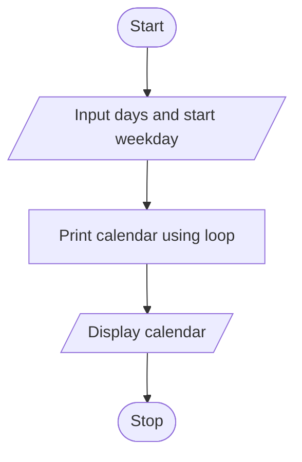

## 1. Problem Statement

Write a Python program to generate a simple calendar for a given number of days and starting weekday using a loop.

## 2. Algorithm

1. Start.
2. Input the number of days and starting weekday.
3. Print the weekday headings.
4. Add spaces for the starting weekday.
5. Print each day using a loop.
6. Move to a new line after every week.
7. Stop.

## 3. Flowchart 

## 5. Sample Input

Enter number of days: 7
Starting weekday (0=Mon, 6=Sun): 0

## 6. Sample Output

Mon Tue Wed Thu Fri Sat Sun
  1   2   3   4   5   6   7
