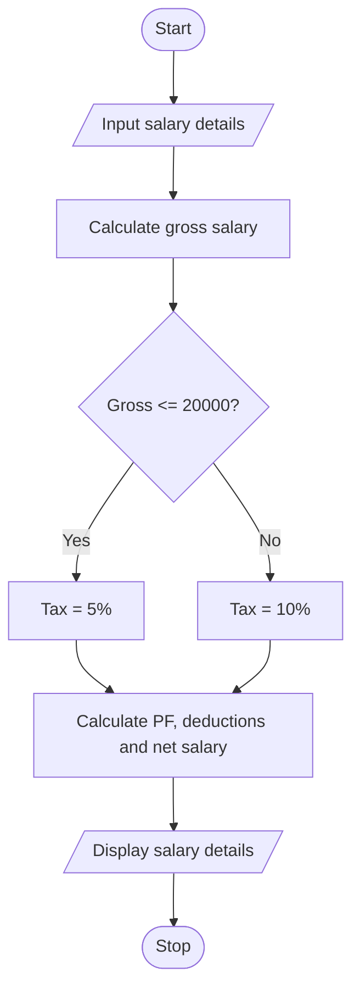

# Employee Payroll and Deduction Analysis

## 1. Problem Statement

Write a Python program to calculate an employee's gross salary, tax, provident fund (PF), total deductions, and net salary based on basic salary, allowances, overtime, and incentives.

## 2. Algorithm

1. Start.
2. Input basic salary, allowances, overtime, and incentives.
3. Calculate gross salary by adding all the inputs.
4. Calculate tax at 5% if gross salary is ₹20,000 or less; otherwise, calculate tax at 10%.
5. Calculate PF as 12% of basic salary.
6. Calculate total deductions by adding tax and PF.
7. Calculate net salary by subtracting deductions from gross salary.
8. Display gross salary, deductions, and net salary.
9. Stop.

## 3. Flowchart 

## 4. Source Code

basic = float(input("Enter basic salary: "))allow = float(input("Enter allowances: "))ot = float(input("Enter overtime: "))bonus = float(input("Enter incentives: "))gross = basic + allow + ot + bonustax = gross * 0.05 if gross <= 20000 else gross * 0.10pf = basic * 0.12deduction = tax + pfnet = gross - deductionprint("Gross:", gross)print("Deductions:", deduction)print("Net Salary:", net)

## 5. Sample Input

Enter basic salary: 15000
Enter allowances: 3000
Enter overtime: 1000
Enter incentives: 1000

## 6. Sample Output

Gross: 20000.0
Deductions: 3300.0
Net Salary: 16700.0
