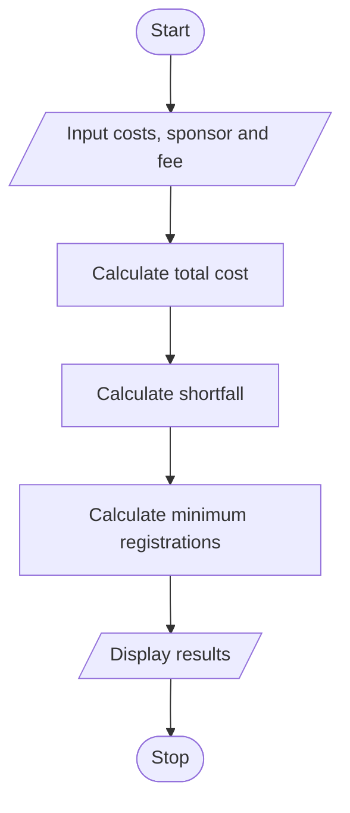

# Campus Event Financial Planning

## 1. Problem Statement

Write a Python program to calculate the total cost of a campus event, sponsorship shortfall, participant contribution needed, and minimum number of registrations required to cover the shortfall.

## 2. Algorithm

1. Start.
2. Input venue, equipment, catering, transport, and certificate costs.
3. Input sponsorship amount and registration fee per participant.
4. Calculate the total event cost.
5. Calculate the sponsorship shortfall.
6. Calculate the minimum registrations required to cover the shortfall.
7. Display the total cost, shortfall, participant contribution, and minimum registrations.
8. Stop.

## 3. Flowchart 

## 4. Source Code

# Campus Event Financial Planningvenue = float(input("Enter venue cost: "))equipment = float(input("Enter equipment cost: "))catering = float(input("Enter catering cost: "))transport = float(input("Enter transport cost: "))certificates = float(input("Enter certificate cost: "))sponsor = float(input("Enter sponsorship amount: "))fee = float(input("Enter registration fee per participant: "))total = venue + equipment + catering + transport + certificatesshortfall = max(0, total - sponsor)participants = int(shortfall / fee) + (shortfall % fee > 0)print("Total Cost:", total)print("Sponsorship Shortfall:", shortfall)print("Participant Contribution Needed:", shortfall)print("Minimum Registrations to Break Even:", participants)

## 5. Sample Input

Enter venue cost: 10000
Enter equipment cost: 5000
Enter catering cost: 8000
Enter transport cost: 2000
Enter certificate cost: 1000
Enter sponsorship amount: 15000
Enter registration fee per participant: 500

## 6. Sample Output

Total Cost: 26000.0
Sponsorship Shortfall: 11000.0
Participant Contribution Needed: 11000.0
Minimum Registrations to Break Even: 22
