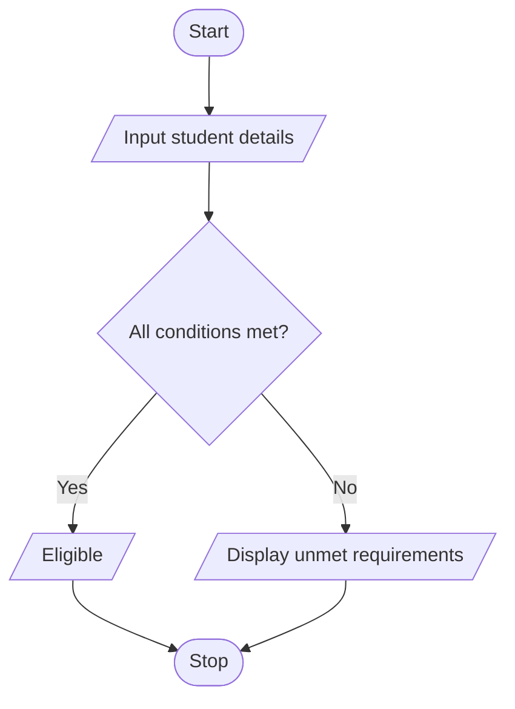

# Multi-Stage Examination Eligibility System

## 1. Problem Statement

Write a Python program to check a student's eligibility for the final examination based on attendance, lab completion, internal marks, and fee payment. Display the reasons if the student is not eligible.

## 2. Algorithm

1. Start.
2. Input attendance percentage, lab completion status, internal marks, and fee payment status.
3. Check whether attendance is below 75%.
4. Check whether the lab is completed.
5. Check whether internal marks are below 40.
6. Check whether fees are cleared.
7. Display all unmet requirements.
8. If all conditions are satisfied, display "Eligible for final examination".
9. Stop.

## 3. Flowchart 

## 5. Sample Input

Enter attendance %: 80
Lab completed (yes/no): yes
Enter internal marks: 45
Fees cleared (yes/no): yes

## 6. Sample Output

Eligible for final examination
