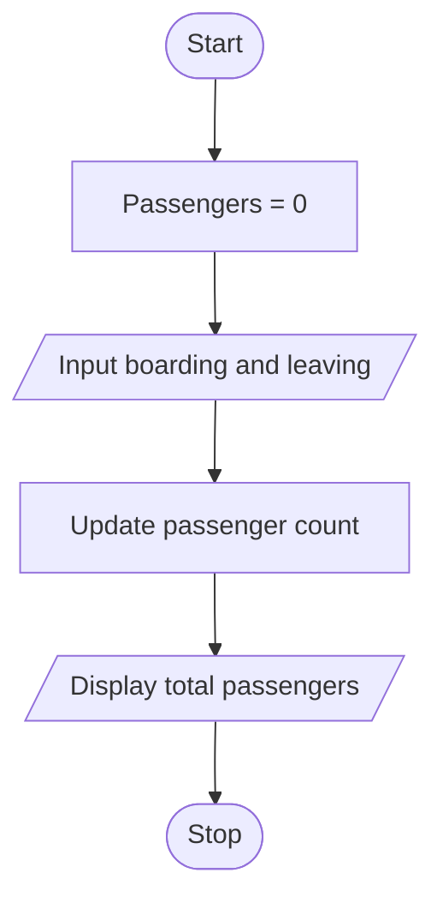

# Bus Passenger Occupancy

## 1. Problem Statement

Write a Python program to calculate the total number of passengers remaining on a bus after three stops by adding boarding passengers and subtracting leaving passengers.

## 2. Algorithm

1. Start.
2. Initialize `passengers = 0`.
3. Repeat for three stops.
4. Input the number of passengers boarding and leaving.
5. Update passengers = passengers + boarding − leaving.
6. Display the total passengers remaining.
7. Stop.

## 3. Flowchart 

## 5. Sample Input

Passengers boarding: 10
Passengers leaving: 2
Passengers boarding: 5
Passengers leaving: 3
Passengers boarding: 4
Passengers leaving: 1

## 6. Sample Output

Total passengers: 13
