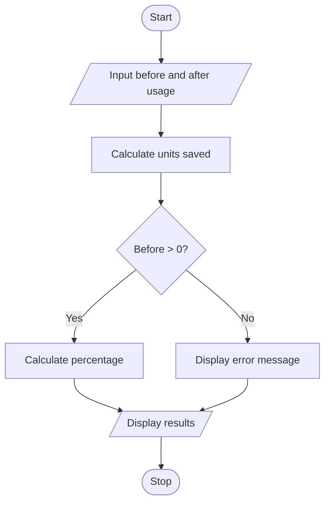

# Energy Conservation Before and After Analysis

## 1. Problem Statement

Write a Python program to calculate the energy units saved by comparing electricity usage before and after conservation measures. Calculate the percentage of energy saved if the initial usage is greater than zero.

## 2. Algorithm

1. Start.
2. Input energy usage before and after conservation.
3. Calculate units saved by subtracting after usage from before usage.
4. Display the units saved.
5. If before usage is greater than zero, calculate the percentage saved.
6. Otherwise, display "Cannot calculate percentage".
7. Stop.

## 3. Flowchart 

## 5. Sample Input

Usage before: 500
Usage after: 350

## 6. Sample Output

Units saved: 150
Percentage saved: 30.0
