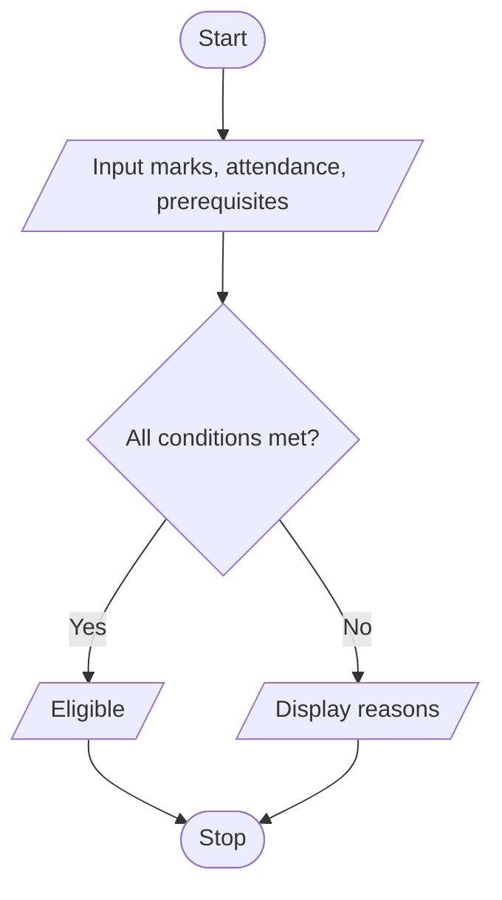

# Academic Progression System

## 1. Problem Statement

Write a Python program to check a student's academic progression eligibility based on semester marks, attendance percentage, and prerequisite completion. Display the reasons if the student is not eligible.

## 2. Algorithm

1. Start.
2. Input semester marks, attendance percentage, and prerequisite status.
3. If marks are below 40, display "Subject not passed".
4. If attendance is below 75%, display "Attendance shortage".
5. If prerequisites are incomplete, display "Prerequisites incomplete".
6. If all conditions are satisfied, display "Eligible for progression".
7. Stop.

## 3. Flowchart 

## 5. Sample Input

Enter semester marks: 65
Enter attendance %: 80
Prerequisites completed (yes/no): yes

## 6. Sample Output

Eligible for progression
