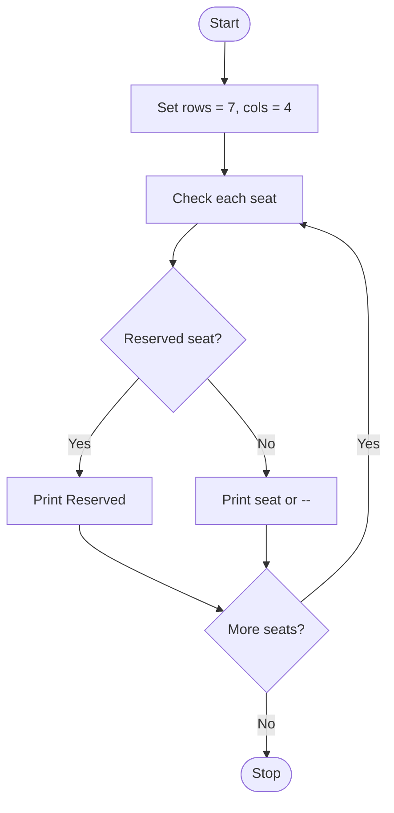

# Examination Seating Generator

## 1. Problem Statement

Write a Python program to generate an examination seating arrangement using 7 rows and 4 columns. Display seat numbers in alternate positions and mark a specific seat as reserved.

## 2. Algorithm

1. Start.
2. Set rows = 7 and columns = 4.
3. Use nested loops to visit each seat.
4. If the seat is (1, 1), print "Reserved".
5. If the sum of row and column indexes is even, print the seat number.
6. Otherwise, print "--".
7. Move to the next row after printing all columns.
8. Stop.

## 3. Flowchart 

## 5. Sample Input

No user input is required. The program uses fixed values:

Rows = 7
Columns = 4
Reserved seat = (1, 1)

## 6. Sample Output

R1C1    --      R1C3    --
--      Reserved --      R2C4
R3C1    --      R3C3    --
--      R4C2    --      R4C4
R5C1    --      R5C3    --
--      R6C2    --      R6C4
R7C1    --      R7C3    --
