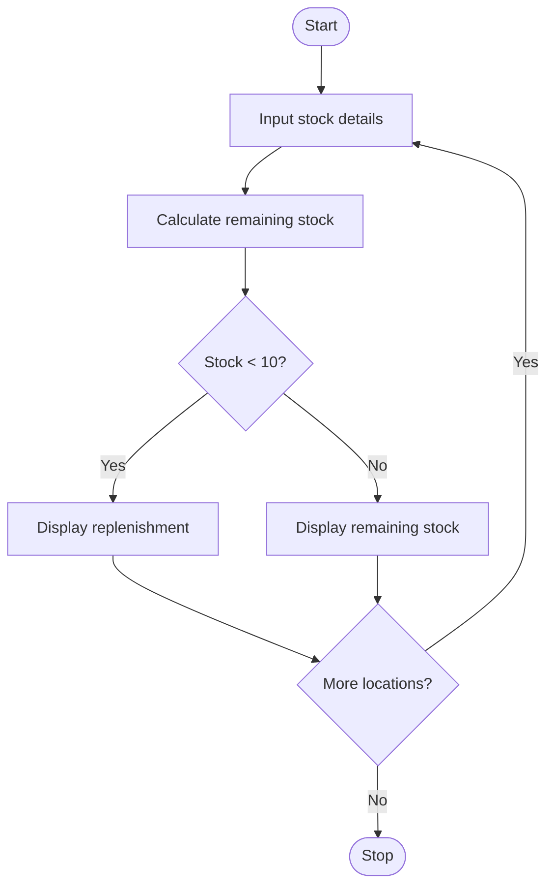

# Food Supply Chain Stock Reconciliation

## 1. Problem Statement

Write a Python program to calculate the remaining food stock at the College, Hostel, and Canteen by subtracting distributed and damaged quantities from the received quantity. If the remaining stock is below 10, display the replenishment quantity. If the stock is negative, display a stock discrepancy warning.

## 2. Algorithm

1. Start.
2. Create a list of locations: College, Hostel, and Canteen.
3. For each location, input received, distributed, and damaged quantities.
4. Calculate remaining stock.
5. Display the remaining stock.
6. If stock is below 10, display the replenishment quantity.
7. If stock is negative, display a stock discrepancy warning.
8. Repeat for all locations.
9. Stop.

## 3. Flowchart 


## 5. Sample Input

```
Quantity received: 50
Quantity distributed: 30
Quantity damaged: 5
Quantity received: 40
Quantity distributed: 35
Quantity damaged: 2
Quantity received: 20
Quantity distributed: 25
Quantity damaged: 1
```

## 6. Sample Output

```
College Remaining: 15
Hostel Remaining: 3
Replenishment needed: 7
Canteen Remaining: -6
Replenishment needed: 16
Stock discrepancy detected
```
